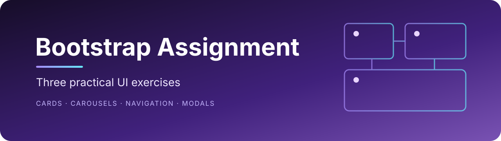
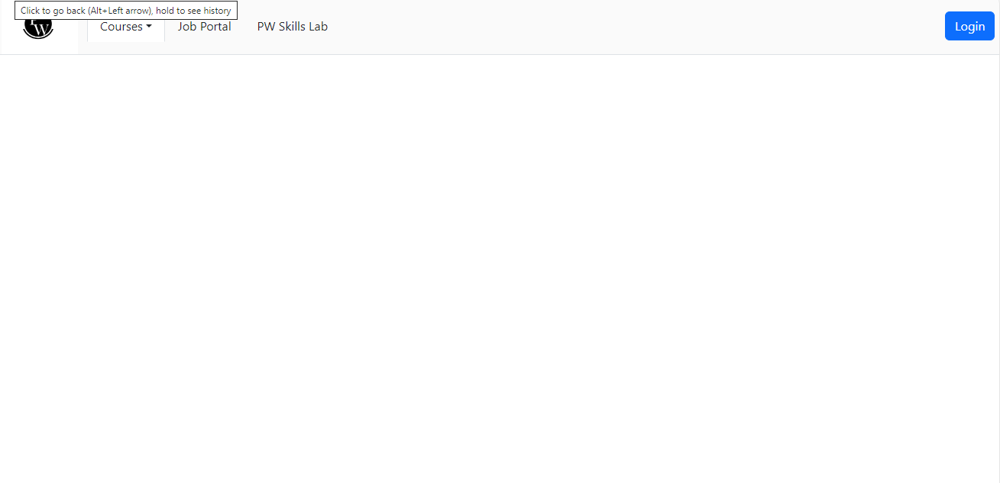
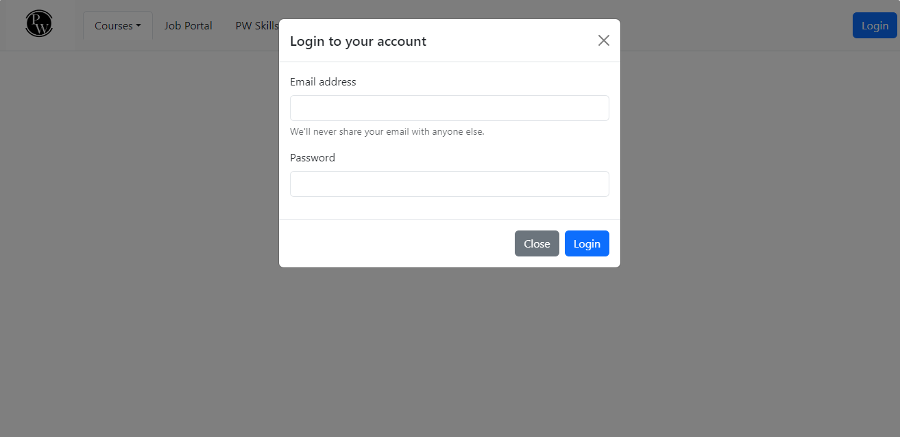
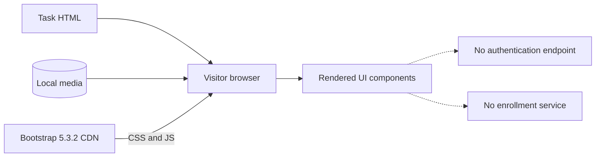

# 🧩 Bootstrap Assignment | Responsive UI Exercises

**Three focused Bootstrap 5.3.2 exercises, from cards to carousels and interactive navigation.**

   

> [!NOTE]
> **Educational scope:** this is a static Bootstrap assignment. The Login modal is a UI demonstration, Enroll Now is a placeholder, and there is no authentication, enrollment API, database, or backend.

A small collection of static HTML exercises built with Bootstrap 5.3.2. The project demonstrates a course card, an image carousel, and a navigation layout with a dropdown and login modal. It is an educational front-end sample, not a complete course platform or authentication application.

## 🎯 Learning Objectives

- Compose responsive interfaces using Bootstrap classes.
- Build a course card and a three-image carousel.
- Use Bootstrap dropdown and modal components.
- Load local images through relative paths.
- Understand CDN dependencies and Subresource Integrity.
- Review responsive design, accessibility and asset licensing.

## 🧭 Exercises

| Page | Demonstration |
| --- | --- |
| Assignment_14_Bootstrap/Task_1.html | A centered course card with an image, course description, and Enroll Now link. |
| Assignment_14_Bootstrap/Task_2.html | A dark Bootstrap carousel with three local images, indicators, timed slides, and previous/next controls. |
| Assignment_14_Bootstrap/Task_3.html | A Bootstrap tab-style navigation bar with a local logo, Courses dropdown, placeholder navigation links, and a login modal form. |

The existing rendered examples are stored in Assignment_14_Bootstrap/output/. Images used by the pages are in Assignment_14_Bootstrap/media/. Keep the relative media paths intact when moving or publishing the HTML files.

## 🖼️ Existing Output Previews

The repository includes saved example renders. They are reference images, not automatically refreshed screenshots.

| Task 1 | Task 2 |
|---|---|
|  |  |

| Task 3 preview A | Task 3 preview B |
|---|---|
|  |  |

## 🏗️ Browser Architecture

## 🚀 Preview locally

No build step, package manager, or server-side runtime is required. Open any Task HTML file directly in a modern browser. For a local HTTP preview, run a static server from the exercise directory:

~~~powershell
cd Assignment_14_Bootstrap
py -m http.server 8000
~~~

Then open http://localhost:8000/Task_1.html, /Task_2.html, or /Task_3.html. If the py launcher is unavailable, use python -m http.server 8000.

The pages load Bootstrap CSS and the Bootstrap JavaScript bundle from jsDelivr. An internet connection is needed for those CDN assets. Without them, the pages' own HTML and local images remain available, but Bootstrap styling and interactive components may not work as intended.

## 🗂️ Repository layout

~~~text
Assignment_14_Bootstrap/
├── Task_1.html
├── Task_2.html
├── Task_3.html
├── media/       # Images referenced by the pages
└── output/      # Saved example renders
docs/            # Project and contributor documentation
~~~

## ⚠️ Current scope and limitations

This repository contains only static HTML and image assets. It has no JavaScript application code, API, database, environment configuration, user accounts, or real login/enrollment flow. The navigation links and Enroll Now link currently point to #. The login modal displays email and password fields, but it does not submit or authenticate credentials. Do not enter real credentials into this demo.

Some image alt attributes are placeholders and should be replaced with meaningful descriptions if the pages are adapted for broader use. Image provenance and reuse permissions are not documented by the source files; verify them before redistributing the images. The MIT license applies to the project code and does not grant rights to third-party assets.

## 🔐 Security, Privacy and Accessibility

- Never enter real credentials into the Task 3 modal.
- The login fields have no submit handler or authentication service.
- The Enroll Now link does not register a user.
- Bootstrap files are fetched from jsDelivr and use SRI metadata. Keep hashes aligned when changing versions.
- Verify image provenance and redistribution rights. The MIT source license does not automatically cover third-party media.
- Add descriptive alt text, meaningful titles, keyboard access, visible focus and reduced-motion consideration before wider use.

See [Security](SECURITY.md), [Privacy](docs/privacy.md), and [Accessibility](docs/accessibility.md).

## 🧪 Testing

There is no automated application test suite. Use [Testing Guide](docs/testing.md) to check local images, CDN requests, carousel controls, dropdown/modal behavior, keyboard access, and responsive layouts.

## 📚 Documentation

See the complete [Documentation Hub](docs/README.md) for project overview, architecture, diagrams, setup, components, API boundary, database status, testing, security, privacy, accessibility, performance, deployment, troubleshooting, ADRs and runbooks.

## 🤝 Contributing and support

See [CONTRIBUTING.md](CONTRIBUTING.md), [CODE_OF_CONDUCT.md](CODE_OF_CONDUCT.md), [SECURITY.md](SECURITY.md), and [SUPPORT.md](SUPPORT.md).

## 📜 License

The project code is available under the MIT License. See LICENSE.

Last updated: 2026-11-16 19:42 UTC
