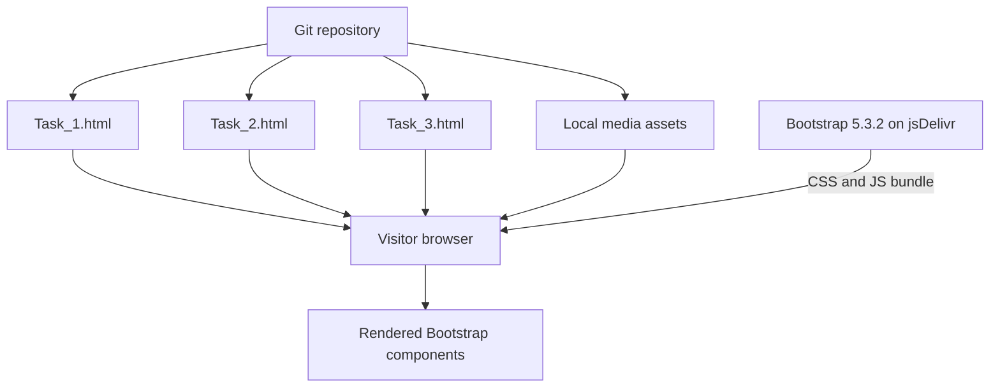

# 🏗️ Architecture

## 1. Overview

Bootstrap Assignment is a static multi-page demonstration. Each task is an independent HTML page. The browser parses the page, requests its local media, and fetches Bootstrap 5.3.2 CSS and JavaScript from jsDelivr.

No application framework, bundler, server, database, or project-authored application JavaScript is present.

## 2. High-level architecture

## 3. Page responsibility boundaries

| Page | Main structure | Bootstrap behavior |
|---|---|---|
| Task 1 | Course card | CSS styling and utility classes |
| Task 2 | Three-image carousel | Bootstrap carousel JavaScript |
| Task 3 | Navigation and modal | Dropdown and modal JavaScript |

## 4. Browser component lifecycle

The browser downloads HTML and referenced assets, builds the DOM, applies Bootstrap CSS, and activates Bootstrap data-API behavior for supported components when the JavaScript bundle is available.

Task 1 does not require Bootstrap JavaScript for the card. Task 2 depends on the carousel plugin. Task 3 depends on dropdown and modal plugins.

## 5. External dependency

The pages use Bootstrap 5.3.2 via jsDelivr. Each page contains integrity and crossorigin attributes. Any version change must update CSS and JavaScript consistently and use integrity values generated for the exact files.

## 6. Asset paths

The `media/` directory is a sibling of the task pages. Relative paths such as `media/filename` are resolved from the HTML page URL. Moving a page without its media directory breaks its images.

## 7. Security and privacy boundary

The browser code is public. The login fields are visual form controls only. They are not transmitted to an authentication service or persisted by the project. Do not enter real passwords.

## 8. Design constraints

Preserve the independent exercise structure unless there is a clear reason to introduce shared templates or a build step. Keep the assignment easy to open, inspect, and understand. Avoid creating server or database architecture for systems not in the repository.
