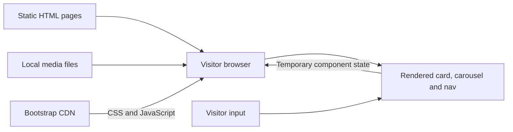

# 🔄 Data Flow and Trust Boundaries

## 1. Current data flow

The project has no business-data pipeline. The flow consists of static HTML delivery, CDN asset requests, local image requests, browser rendering, and Bootstrap's built-in client-side component interactions.

## 2. Trust boundaries

| Boundary | Data | Risk/consideration |
|---|---|---|
| Repository to browser | HTML and local images | Review repository changes and asset provenance |
| jsDelivr to browser | Bootstrap CSS/JS | CDN availability, integrity, version consistency |
| User to modal form | Email/password text fields | Current form is not submitted; never collect real credentials |
| CTA to enrollment | Placeholder anchor | No enrollment destination exists |

## 3. Task 1 flow

The browser renders the course card and a link. The link points to `#`; there is no form submission, API call, or enrollment record.

## 4. Task 2 flow

The browser loads images from `media/` and Bootstrap's JavaScript bundle from jsDelivr. Bootstrap manages temporary carousel state as visitors activate indicators or previous/next controls. There is no persistence of slide choice.

## 5. Task 3 flow

The browser renders the navigation. Bootstrap's JavaScript bundle handles dropdown and modal behavior. The login fields remain presentation-only. No credentials are sent to a project-owned service and no session is created.

## 6. Future data-backed flow

If login or enrollment is ever implemented, use a secure server-side boundary. A static page must not embed database credentials or privileged API keys. Document data minimization, validation, authorization, retention and deletion before collecting real user information.
