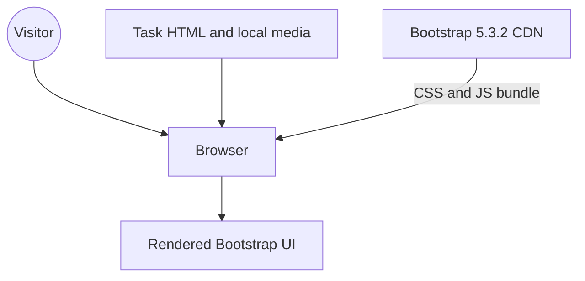

# 🧩 System Design

## 1. System context

Bootstrap Assignment is a browser-only collection of exercises. A visitor loads one HTML page. The page references local media and Bootstrap 5.3.2 assets hosted on jsDelivr.

## 2. Functional boundaries

- Task 1 renders static course information.
- Task 2 delegates carousel state and controls to Bootstrap JavaScript.
- Task 3 delegates dropdown and modal behavior to Bootstrap JavaScript.
- No project-owned server-side process is involved.

## 3. State ownership

The browser maintains temporary state for carousel index, dropdown visibility, and modal visibility. This is interaction state managed by Bootstrap. The repository does not persist it between visits.

## 4. Security model

The HTML and all client-side assets are public. No secret can be protected inside these files. The email/password modal fields are not an authentication mechanism. Never request real passwords through the demonstration.

## 5. Proposed future architecture

A real course registration or login system would require an authenticated server-side service, explicit data model, authorization checks, secure session management, privacy policy, monitoring, backup and incident response. This is a future product design, not the current implementation.

## 6. Quality principles

1. Keep examples understandable and focused.
2. Keep Bootstrap version and SRI metadata accurate.
3. Preserve relative media paths.
4. Provide accessible controls and accurate alt text.
5. Separate demonstration UI from production business functionality.
6. Document third-party asset provenance.
